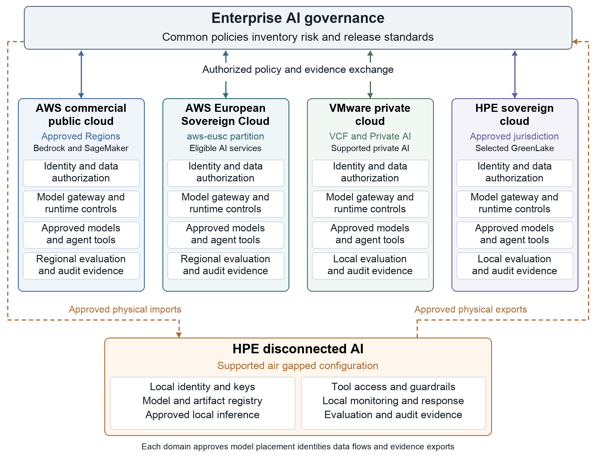

# Sovereign AI Stack — Enterprise Blueprint & Reference Implementation

**Enterprise AI governance across AWS, AWS European Sovereign Cloud, VMware and HPE GreenLake.**

One enterprise governance model, enforced *inside* every deployment boundary — including
disconnected sites that must operate their controls locally.



[](https://github.com/cybersmeashish/sovereign-AI/actions/workflows/ci.yml)


---

## What's in this repository

| Path | Contents |
|---|---|
| [`docs/blueprint.md`](docs/blueprint.md) | Full blueprint (14 sections + references); original `.docx` alongside |
| [`docs/architecture.md`](docs/architecture.md) | Domain + request-path diagrams, control-to-code map |
| [`docs/acceptance-criteria.md`](docs/acceptance-criteria.md) | §14 production acceptance evidence mapped to tests |
| [`docs/operating-model.md`](docs/operating-model.md) | RACI and staged rollout |
| [`docs/hybrid-flows.md`](docs/hybrid-flows.md) | Cross-boundary flow controls |
| [`src/sovereign_ai/`](src/sovereign_ai) | Python reference control plane (placement, policy bundles, manifests, retrieval, tool gateway, evidence, air-gap) |
| [`policies/`](policies) | OPA/Rego policies + tests (placement, tool authorization, release gates) |
| [`schemas/`](schemas) | JSON Schemas: sovereignty profile, release manifest, use-case inventory |
| [`examples/`](examples) | Sample profiles for all five domains, endpoint catalogue, manifest, inventory |
| [`infra/aws-commercial`](infra/aws-commercial) | Terraform: KMS, scoped role, Bedrock PrivateLink, Guardrail, Object-Lock evidence, CloudTrail, SCP |
| [`infra/aws-eusc`](infra/aws-eusc) | Terraform for the `aws-eusc` partition with partition guard |
| [`infra/vmware-private`](infra/vmware-private) | Kubernetes: vLLM, AI gateway + OPA sidecar, default-deny NetworkPolicy |
| [`infra/hpe-greenlake`](infra/hpe-greenlake) | Sovereign & air-gapped operating notes, physical transfer workflow |
| [`scripts/`](scripts) | Air-gap bundle build / verify / promote |

## The five deployment domains

| Domain | Platform basis | Workload pattern |
|---|---|---|
| `aws-commercial` | Approved commercial AWS Regions & accounts | Managed AI services, elastic processing of approved data |
| `aws-eusc` | Separate `aws-eusc` partition + EU landing zone | Workloads needing EU operational & data controls |
| `vmware-private` | VMware Cloud Foundation + Private AI services | Internal assistants near enterprise data |
| `hpe-sovereign` | HPE GreenLake private cloud / Private Cloud AI | Defined local ownership & operational control |
| `hpe-disconnected` | Supported air-gapped HPE configurations | Isolated inference, retrieval, model maintenance |

## Quick start

```bash
git clone https://github.com/cybersmeashish/sovereign-AI.git && cd sovereign-AI
python -m venv .venv && source .venv/bin/activate
pip install -e ".[dev]"
make test            # pytest + opa test (if opa installed)

# Placement decision for a restricted engineering prompt
sovai place --profile examples/profiles/restricted-engineering.json \
            --endpoints examples/endpoints.json \
            --model llama-3.1-70b-instruct --data-class restricted

# Sign and verify a release manifest
export SOVAI_SIGNING_KEY=dev-only-key
sovai sign-manifest examples/release-manifest.example.json --artifacts examples --out /tmp/m.json
sovai verify-manifest /tmp/m.json --target vmware-private --artifacts examples

# Run the local AI gateway
pip install -e ".[gateway]" && uvicorn sovereign_ai.gateway_app:app --port 8080
```

## Design principles

1. **Define sovereignty before selecting the runtime** — jurisdiction, operational autonomy and connectivity are separate requirements.
2. **Hybrid is a relationship, not a location** — every boundary crossing is an explicit, approved flow.
3. **Fail closed** — no eligible endpoint ⇒ deny or queue; commercial resources never silently substitute for sovereign ones.
4. **Retrieved content is untrusted** — it can't grant permissions, change destinations or authorise tools.
5. **Approvals bind to exact actions** — hashed parameters, single use, expiring.
6. **Evidence without disclosure** — hash-chained logs, minimised exports stamped with time and policy version.

## Standards alignment

NIST AI RMF · ISO/IEC 42001 · EU AI Act (Regulation (EU) 2024/1689) · OWASP Top 10 for LLM Applications (LLM01, LLM06) · AWS Security Reference Architecture for Generative AI.

## Disclaimer

Product capabilities inform the design; deployment policies, integration choices and operating
requirements are **proposed enterprise controls**. Verify service, model and feature availability in
your chosen Regions/partitions and supported vendor configurations before production use. The HMAC
signer is for labs and tests — use KMS/HSM-backed asymmetric keys in production.

## License

Apache License 2.0 — see [LICENSE](LICENSE).

**Author:** Ashish Srivastava
