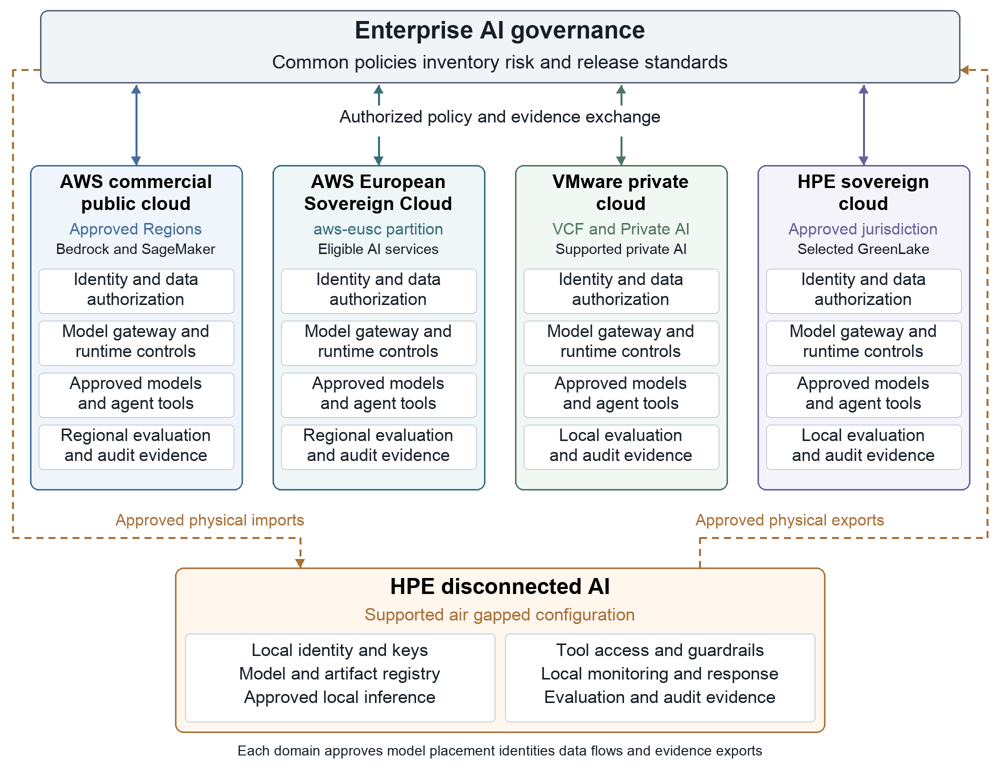
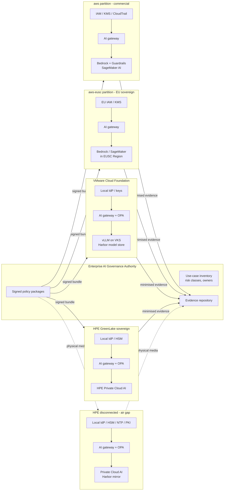
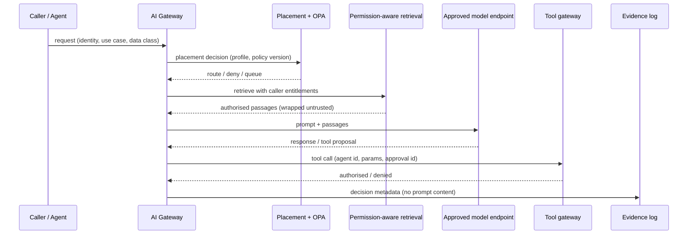

# Reference architecture

## Domains and boundaries

## Request path inside any domain

## Module map

| Blueprint control | Code | Policy |
|---|---|---|
| Sovereignty profile (§1) | `sovereign_ai/profile.py`, `schemas/sovereignty-profile.schema.json` | — |
| Placement / inference routing (§3, §11) | `sovereign_ai/placement.py` | `policies/placement.rego` |
| Signed, versioned policy with offline validity (§7) | `sovereign_ai/policy_bundle.py` | OPA signed bundles |
| Permission-aware retrieval, injection handling (§8) | `sovereign_ai/retrieval.py` | — |
| Agent identity, bound approvals, suspension (§9) | `sovereign_ai/tool_gateway.py` | `policies/tool_authz.rego` |
| Signed release manifests and gates (§10) | `sovereign_ai/manifest.py` | `policies/release.rego` |
| Air-gap import/export (§12) | `sovereign_ai/airgap.py`, `scripts/airgap_bundle.py` | — |
| Evidence & disclosure-minimised export (§7, §14) | `sovereign_ai/evidence.py` | — |
